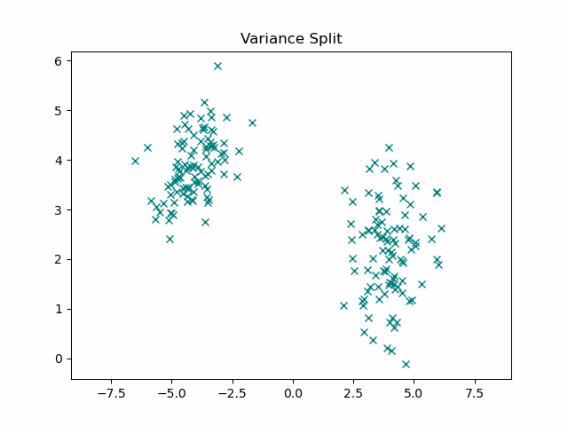
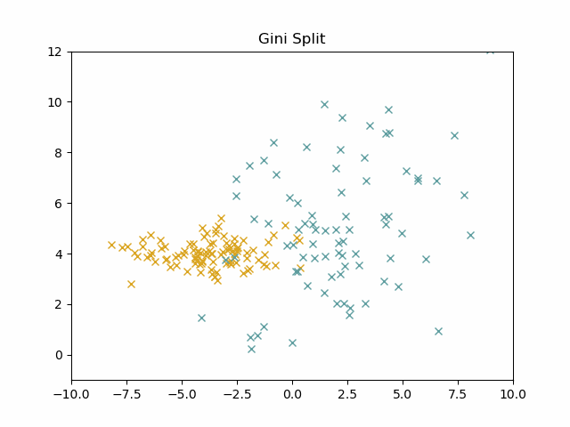
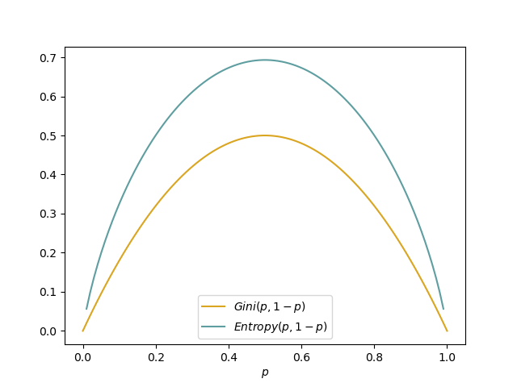

**Foreword**: This is a visual very beginner friendly guide to Tree models, from the humble decision tree to its gradient boosted version.

## Decision Trees
Decision trees are so intuitive to understand that everyone who has been introduced to ML by the black-*(magic-straight-from-the-forbidden-section-of-the-library)*-box that is ChatGPT, will be surprised they even qualify as Machine Learning. But they do and rightfully so. Decision trees allow you to efficiently and above all **interpretably** structure your data, picking up on linear and non linear relationships in a rule based approach.

%include data simple

If I told you to find a rule to structure this data, you would most likely have an intuitive idea of where to begin. You would first split the data at xy, simply because it seperates your data the best. And thats what decision trees do: They try to split the data into sections, in way that seperates it the best.

*See? You could have build this, right?*

The key to decision trees, or arguably most of ML, is to translate this intuitive notion of "seperating your data the best" into a mathematical problem.
### The splitting criterium
To decide where to set a split, the decision tree algorithm optimises for a metric that tells you how "clean" the data in the resulting nodes is. Depending on whether you have a regression or classification problem, popular choices include:

#### Variance
$Var = \frac{1}{n}\sum_{i=1}^n (x_i-\mu)^2$

The variance gives you the mean euclidean distance of all samples from the mean. It's the most common choice for regression problems where the goal is to minimize the Variance in a node.
The intuition here being, that we want to find samples similar to each other, therefore minimizing the variance.

#### The Gini Impuriti
$Gini = 1-\sum_{i=1}^C p_i^2$

Where $C$ is the number of classes in the datset and $p_i$ gives you the probability of randomly drawing a sample of class $i$ within the node. Note that the Gini impurity is 0 if all the samples in the node belong to the same class.

#### Entropy
$H = -\sum_{i = 1}^C p_ilog(p_i)$

The entropy of a source gives you its information content. And in this case our goal is to minimize it. Note that the entropy is 0 if all samples belong to the same class which will therefore be drawn with a probability of 1.

Note that Gini Impurity and the Entropy are interchangable, as they have the same optimium.

### The Algorithm
Yes the ominous algorithm strikes again, it is indeed not prevy to TikTok only and in fact not the singular instance of general intelligence that your favourite podcaster makes it out to be.

If you ever wondered what a real life manifestation of an algorithm looks like, this is an algorithm:

    while True:
      breathe

Now that we are no longer afraid of the word, lets have a look at the algorithm we are actually interested in:
    
    def split_node(depth):
      # find split feature and split which minimizes splitting criterium
      min_split_purity = inf
      min_split = 0
      split_feat = None

      for feat in features:
        data = data.sort_by(feat)
        for i in range(len(data)):
          split = median(data[i,feat],data[i+1,feat])
          left_node = data[data.feat<=split]
          right_node = data[data.feat>split]
          node_purity_left = splitting_criteria(left_node)
          node_purity_right = splitting_criteria(right_node)
          mean_purity = mean(node_purity_left, node_purity_right)
          if min_split_purity > mean_purity:
            min_split_purity = mean_purity
            min_split = split
            split_feat = feat

      #split 
      left_node = split_node(data[data[split_feat]<=split])
      right_node = split_node(data[data[split_feat]>split]) 

    

  
So we first choose the feature axis and split which minimizes our splitting criterium the best. 
Where leaf_pred is usually given by mean(leaf) if we have a regression and majority(leaf) if we have a classification problem.
### Example
Here you can watch a real life algorithm seperate data in real time *(This is a lie, it's actually pre recorded)*:

todo  vis tree split
### Parameter
- **max_tree_depth**:
You have probably noticed that our algorithms stops at some point and doesn't split our data into perfectly clean clusters. While this might be triggering to the perfectionists among you, this behaviour is indeed desired. Because if we would continue, we would at some point go into overfitting terretorium, meaning instead of picking up on general patterns, we would just learn the data by heart.
This is why we tell the decision tree to stop at some point, the default value for this parameter is usually nlogn where n is the number of classes.
### Pros and Cons
The most compelling selling point of decision trees is obviously that you can actually follow the decision making process. This is especially important for real life applications of ML and the reason why decision trees are the poster child of explainable AI.
Further, they can handle unnormalized data from different sources, continous as well as categorical and are not affected by redundancy. They are also robust to outliers and can handle missing data. \
You can apply them to Regression as well as Classification tasks. Nevertheless, they can be a bit oversimplifying for some problems - *but you don't have to throw a neural network on them yet*
